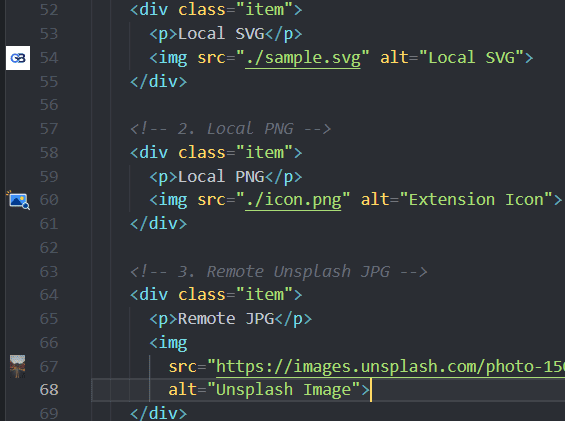
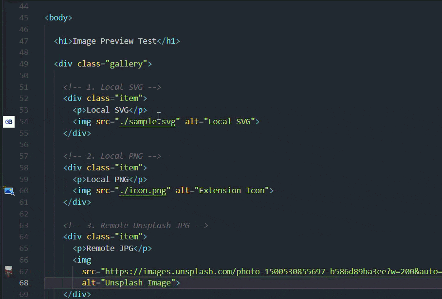

# Img Preview

***Img Preview** — Fast & Lightweight Image Previews for VS Code*

---

**Img Preview** is a fast, lightweight VS Code extension that brings image previews directly into your coding workflow. It displays thumbnails in the editor gutter and provides rich hover previews with image dimensions, file size, and format information.

No more switching between editor tabs or opening file explorers just to identify an image asset!

  

---

## ✨ Features

- 🎯 **Gutter Thumbnail Previews**: See miniature image previews directly beside line numbers for referenced images in your code.
- 🔍 **Rich Hover Cards**: Hover over an image path or URL to view:
  - Image preview
  - Pixel dimensions (`width × height`)
  - Formatted file size (`KB` / `MB`)
  - Detected image format and MIME type
  - Quick action to **Reveal in File Explorer**
  - Quick action to **Copy as Data URI**

  

- 📋 **Copy as Data URI (Base64)**:
  -Convert an image into an inline Base64 Data URI and copy it to your clipboard.
  -Available through the Command Palette and editor context menu.
- 📊 **Status Bar Counter**:
  - Displays the number of images detected in the active document.
  - Click the counter to toggle gutter previews.
- ⚡ **Lightweight & Performance Optimized**:
  - Debounced scanning to reduce unnecessary processing while typing.
  - Decoration pooling to reuse editor resources efficiently.
  - Header-based image inspection to retrieve dimensions without reading entire image files when possible.
- 🌐 **Flexible Path Resolution**:
  - Relative paths (`./icons/logo.svg`, `../assets/banner.webp`)
  - Common framework aliases (`@/assets/...`, `~/images/...`)
  - Workspace root and `/public` or `/static` asset paths
  - Inline Data URIs (`data:image/svg+xml;...`, `data:image/png;base64,...`)
  - Remote HTTP/HTTPS image URLs with local caching

---

## 🎨 Supported Image Formats

| Format | Extensions | Format | Extensions |
| :--- | :--- | :--- | :--- |
| **SVG** | `.svg` | **WebP** | `.webp` |
| **PNG** | `.png`, `.apng` | **JPEG / JPG** | `.jpeg`, `.jpg` |
| **GIF** | `.gif` | **AVIF** | `.avif` |
| **ICO** | `.ico` | **BMP** | `.bmp` |
| **TIFF** | `.tiff`, `.tif` | **Data URIs** | `data:image/*` |

---

## 🛠️ Language & File Support

**Img Preview** detects image references in **supported source files**, including:

- **Web & Frontend**: HTML, JSX, TSX, Vue, Svelte, Astro, CSS, SCSS, LESS
- **Programming Languages**: JavaScript, TypeScript, Python, Rust, Go, PHP, C#, Ruby, Dart, Swift
- **Markup & Data**: Markdown, MDX, JSON, YAML, TOML, XML

---

## ⚙️ Configuration Settings

Customize **Img Preview** through VS Code Settings (`Ctrl+,` or `Cmd+,`):

| Setting | Type | Default | Description |
| :--- | :--- | :--- | :--- |
| `imgPreview.enableGutter` | `boolean` | `true` | Show thumbnail previews in the editor gutter. |
| `imgPreview.enableHover` | `boolean` | `true` | Show rich preview cards on hover. |
| `imgPreview.gutterIconSize` | `string` | `"contain"` | Gutter icon scaling mode (`contain`, `cover`, `auto`). |
| `imgPreview.debounceDelay` | `number` | `200` | Delay in milliseconds before re-scanning after typing. |
| `imgPreview.maxFileSizeMB` | `number` | `25` | Maximum image file size in MB to inspect. |
| `imgPreview.enableRemoteImages` | `boolean` | `true` | Enable downloading and caching remote `http`/`https` images. |
| `imgPreview.supportedExtensions` | `array` | *(All formats)* | File extensions recognized by the scanner. |

---

## ⌨️ Commands

Access these commands through the Command Palette (`Ctrl+Shift+P` / `Cmd+Shift+P`):

- **`Img Preview: Toggle Gutter Previews`**: Toggle gutter thumbnails on or off.
- **`Img Preview: Clear Image Cache`**: Clear locally cached image data.
- **`Img Preview: Copy Image as Data URI (Base64)`**: Copy an image as an inline Data URI string. Also available through the editor context menu.

---

## 🤝 Contributing & Feedback

Have an idea for a new feature or found a bug? Contributions and feedback are welcome!

- 🐛 [Report a bug](https://github.com/chouhan-rahul/imgpreview/issues)
- 💡 [Request a feature](https://github.com/chouhan-rahul/imgpreview/issues)
- 💬 [Join Discussions](https://github.com/chouhan-rahul/imgpreview/discussions)
- 🤝 [Contributing Guidelines](https://github.com/chouhan-rahul/imgpreview/blob/main/CONTRIBUTING.md)
- 📖 [Code of Conduct](https://github.com/chouhan-rahul/imgpreview/blob/main/CODE_OF_CONDUCT.md)
- 🔒 [Security Policy](https://github.com/chouhan-rahul/imgpreview/blob/main/SECURITY.md)

---

## 💖 Support & Sponsoring

If **Img Preview** saves you time and improves your development workflow, consider supporting its continued development.

- [❤️ Sponsor on GitHub](https://github.com/sponsors/chouhan-rahul)
- [☕ Buy Me a Coffee](https://buymeacoffee.com/rahulchouhan)
- [🍵 Support on Ko-fi](https://ko-fi.com/rahulchouhan)
- [💙 Donate via PayPal](https://paypal.me/iamchouhanrahul)

Every bit of support is appreciated!

---

## 📄 License

>Licensed under the [BSD 3-Clause License](https://github.com/chouhan-rahul/imgpreview/blob/main/LICENSE). Built with ❤️ by [Rahul Chouhan](https://github.com/chouhan-rahul).